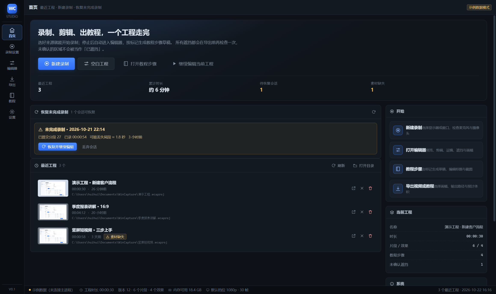

# WinCapture Studio

Windows 录屏与图文教程制作工具。选好来源就能开始录制；停止后自动进入编辑器，按标记生成教程步骤草稿。所有遮挡都会在导出前再检查一次，未确认的区域不会被当作「已遮挡」。



## 功能

- **录制**：全屏/区域采集（GDI 常驻工作进程）、系统声音（WASAPI 回环）+ 麦克风双轨、1.6 秒一个独立可解码 MP4 分段（崩溃最多丢 4 秒，实测尾部损失 1.6 秒）
- **摄像头画中画**：独立隐藏窗口采集，与屏幕段同索引同时长落盘，导出时按 `camera` 轨道合成；设备不可用只降级提示，绝不中断录制
- **暂停/恢复/标记**：悬浮控制条 + 全局快捷键（Ctrl+Alt+R 录制/停止、Ctrl+Alt+P 暂停、Ctrl+Alt+M 标记），输出时长不包含暂停时间
- **非破坏性时间线编辑**：分割 / 删除（含关联轨 ripple）/ 裁剪 / 移动 / 拖拽重排，完整撤销重做（undo 后 revision 仍单调递增）
- **自动运镜**：按指针活跃区与停留时间生成缩放关键帧，分辨率不足时自动限制放大倍数
- **隐私遮挡**：预览上直接框选，实色 / 模糊 / 马赛克三种样式；未确认的遮挡明确显示「未遮挡」，绝不静默当作已遮挡
- **音频波形**：时间线显示真实波形，静音段显示为直线
- **导出**：1080p/720p、16:9 / 1:1 / 9:16 三种画幅，H.264 + AAC（优先硬件编码），先写 `.partial` 再校验再原子改名，取消不留残留文件
- **图文教程包**：`index.html` + `tutorial.md` + `steps.json` + `assets/step-NN.png`，截图与视频共用同一套合成管线（所见即所得）
- **工程**：`.wcaproj` 目录（工程 JSON 原子替换 + 上一版快照 + 自动保存），`.wcapack` 打包/导入，崩溃后按 journal 重建已提交分段

## 快速开始

```powershell
npm install
npm run build     # 原生工作进程(csc) + 主进程(esbuild) + 界面(vite)
npm start         # 启动应用
```

前置要求：Windows 10/11、Node 22+、.NET Framework 4.x（`C:\Windows\Microsoft.NET\Framework64\v4.0.30319\csc.exe`，仅编译期使用）。

开发模式：`npm run dev`（Vite 热更新 + 主进程已构建产物）。需要 `ELECTRON_RUN_AS_NODE` 未设置、`--no-sandbox` 参数（本机实测必须）。

受限制环境（AppData 不可写等）：设置环境变量 `WCS_USER_DATA=<目录>` 指定数据目录；工程输出目录会自动从「视频」回退到数据目录。

## 测试与验证

```powershell
npm test                    # 453 个领域层单元测试（含 5 处固定种子 200 组的属性测试）
npm run typecheck           # TypeScript 全仓类型检查
npm run verify:capture      # GDI/WASAPI 采集探针
npm run verify:e2e          # 合成帧 → 编码 → 解封装校验
```

自动化探针（无需人工干预，真实跑完整链路）：

| 探针 | 环境变量 | 验证内容 |
|---|---|---|
| 界面截图 | `WCS_SELFTEST=screenshot` | 主进程 + 真实 IPC + 界面渲染，输出截图与 DOM 统计 |
| 录制链路 | `WCS_RECORDER_PROBE=1` | 真实 GDI/WASAPI 采集 → 分段编码 → 工程落盘 → journal/指针日志 |
| 端到端 | `WCS_E2E_PROBE=1` | 录制 → 工程 → 导出 1080p MP4（含画面内容检查）→ 教程包 |
| 性能基准 | `WCS_PERF_PROBE=1` | 对照 §16.2 的全部指标（首帧延迟、丢帧率、音画偏差、尾部损失、工作集、导出速度） |
| 摄像头 | `scripts/verify-camera.cjs` | 设备枚举 → 打开 → 快照 → 2 秒编码 → 独立解封装 |

结果写入 `dist/verify/*.json`。

### 性能基准实测（§16.2，1080p@30fps，20 秒）

| 指标 | 目标 | 实测 | 结论 |
|---|---|---|---|
| 首次有效画面 | ≤2000ms | 160–240ms | ✅ |
| 处理超时丢帧率 | ≤0.5% | 0% | ✅ |
| 音画偏差 | ≤80ms | 2–20ms | ✅ |
| 故障尾部损失 | ≤4s | 1600ms | ✅ |
| 1080p 导出速度 | ≤实时 | 5.8–7.5× 实时 | ✅ |
| 总工作集 | ≤1.2GB | 2136MB | ❌ 已知限制 |

工作集未达标：已修掉三处真实缺陷（编码窗口未复用导致每段泄漏约 370MB、管道
`subarray` 造成 Buffer 滞留、编码器资源不释放），峰值从 3633MB 降到 2136MB（-41%），
剩余部分是 Electron 多进程固定开销与 1080p 帧在「主进程→渲染进程」链路的多份副本。
要压进 1.2GB 需把编码下沉到采集进程侧（帧不经过主进程内存），属结构性重做，
当前如实记录为限制，详见 `docs/acceptance.md`。

## 架构

```
electron/
  native/grabber.cs    常驻 GDI 抓帧进程（JPEG 流，QPC 时间戳）
  native/audio.cs      常驻 WASAPI 进程（系统回环 + 麦克风，48kHz Float32）
  capture/             采集引擎、状态机、QPC 时钟、工作进程管理
  main.ts              主进程：窗口、IPC、快捷键、单实例、文件白名单
  preload.ts           contextBridge 暴露 window.wcs
  projectStore.ts      工程原子写入、最近列表、恢复、打包
src/
  domain/              纯逻辑：时间基、命令/撤销、场景求值、导出计划、校验、迁移、恢复
  media/               encode(SegmentEncoder/ContinuousMuxer) decoder exporter compositor
  renderer/            React 界面 + recorder/exporter 隐藏窗口运行时
  shared/              IPC 契约、错误码、window.wcs 类型
```

预览与导出共用 `evaluateScene → drawScene`（`src/media/compositor.ts`），保证「所见即所得」；教程截图也走同一条路径。

## 已知边界（诚实声明）

- 窗口采集（Windows Graphics Capture）在本机被策略拒绝（`E_ACCESSDENIED`，见 `docs/technical-verification.md`），界面如实标注「不可用」，全屏与区域采集不受影响
- 摄像头：本机 Chromium 媒体层拒绝物理摄像头（`NotAllowedError`，尽管 Windows 隐私设置已允许），代码路径已用 Chromium 虚拟摄像头设备完整验证（枚举 → 打开 → 快照 → 编码 → 解封装 1280×720 avc 2.000s），真实摄像头需在正常环境复验
- WASAPI 回环在没有声音播放时不产生数据包——这是回环机制本身的行为，界面显示「无信号」而不是报错
- 系统不支持窗口内容保护时，悬浮控制条可能出现在录制画面里（启动时会提示）
- 1080p 录制总工作集 2136MB，未达到 §16.2 的 1.2GB 目标（原因见上一节）
- 浏览器引擎要求关闭 GPU 沙箱（`disable-gpu-sandbox`，已在应用内设置）：受限环境下隐藏窗口连续硬件编码否则会让渲染进程崩溃
- 纯音频导出（M4A）为 P1 能力，当前版本未启用

## 第三方组件

- [Electron](https://www.electronjs.org/)（MIT）
- [React](https://react.dev/)（MIT）
- [mediabunny](https://mediabunny.dev/)（MIT）— MP4 封装/解封装
- [Vite](https://vite.dev/) / [esbuild](https://esbuild.github.io/) / [vitest](https://vitest.dev/)（MIT）
- [TypeScript](https://www.typescriptlang.org/)（Apache-2.0）
