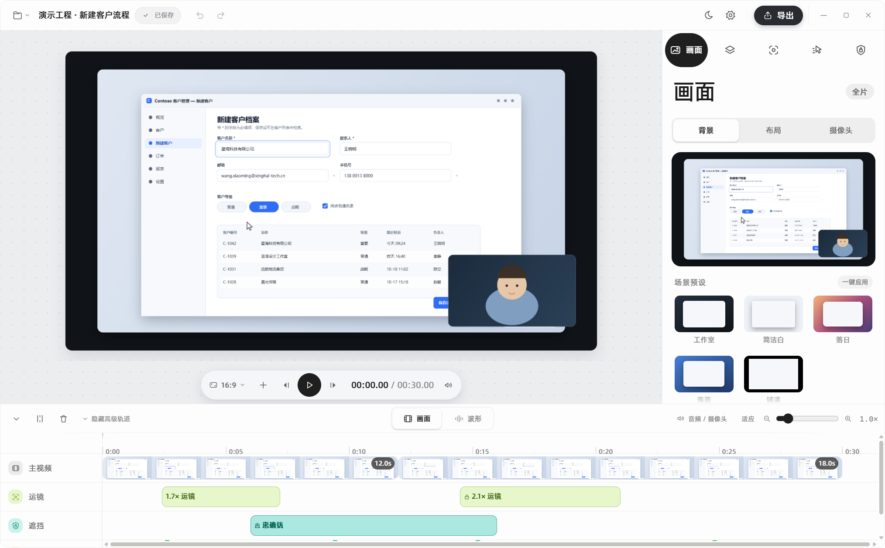

# WinCapture Studio

Windows 录屏、非破坏性剪辑与图文教程制作工具。参考 [DogSC](https://github.com/laogou717/dogsc) 的工作流，使用 Electron、React、TypeScript 和 Windows 原生采集实现。

启动即显示录制胶囊：选择窗口、区域、设备或显示器，在更多面板完成录前准备，确认桌面录制范围后开始。停止后进入浅色剪辑台；已支持鼠标自动缩放、音轨试听和同步导出。设备模式支持系统识别的摄像头与 USB 采集卡。



## 功能

- 全屏、区域、独立窗口录制；现代 Chromium/WGC 采集入口，失败自动回退 GDI/PrintWindow，也可在设置中手选。
- 兼容采集采用有界帧池并行抓帧/编码；支持“清晰优先/帧率优先”缩放，设置随重启保留。
- Windows 全局鼠标按钮钩子，使用 QPC 记录按下/释放、物理坐标；源区域换算、暂停排除、光标轨迹与点击反馈。
- 摄像头真实取景，共用预览和录制连接；连续采样后按屏幕段媒体时间切片，暂停期间不采入，停止后不补录未来画面。
- 系统声音与麦克风双轨、暂停恢复、标记、悬浮控制条和全局快捷键；悬浮条与启动胶囊可拖拽（⠿ 把手），托盘提供录制中兜底的「停止并保存」入口（左键单击即停）。
- 停止录制后右下角弹出完成卡片：视频首帧缩略图、时长与分辨率，一键「进入编辑」或打开工程文件夹。
- 时间线分割、裁剪、移动、删除、关联轨联动、0.25–4 倍变速与撤销重做；音频用 WSOLA 时间拉伸变速并保持音调；真实视频缩略图和音频波形，磁吸片段边界/播放头，Alt 临时关闭磁吸。
- 自动缩放与三轴 3D 透视运镜；预览、视频和教程截图共用合成器，GPU 不可用时回退软件绘制。
- 背景、留白、圆角、阴影、光标样式、效果复制粘贴；实时音频试听跟随剪辑、增益、静音和变速。
- 隐私遮挡：实色为完全不透明；模糊与马赛克对源像素真正执行高斯模糊与像素化，取样不可用时自动回退为不透明遮盖。
- MP4（H.264/AAC）、M4A 纯音频、HTML/Markdown 教程导出；支持多画幅、720p–4K、30/60 FPS 输出。
- 分段 MP4、独立 WAV、工程原子保存、自动保存、崩溃恢复与工程包导入导出。

功能边界和未完成项目见 [当前状态](docs/status.md)。本机内置摄像头的真实取景与编码已验证；多设备、拔插和长时间同步仍需复验，不能视为所有硬件均已通过。

## 运行

要求 Windows 10/11、Node.js 22+、.NET Framework 4.x 编译器。原生进程由系统 Framework64/v4.0.30319/csc.exe 构建。

```powershell
npm ci
npm start
```

Windows 启动器会将已安装的 Electron 运行时缓存到 `%LOCALAPPDATA%/WinCaptureStudio/runtime/`，源码和工程仍在原处。本机源码目录内的可执行文件触发 Windows 路径安全区域判定异常，曾导致摄像头已授权却报拒绝；从正常本地运行目录启动已恢复。首次启动需要复制一次运行时，不修改系统权限设置。

npm run dev 启用界面热更新。受限环境可设置 WCS_USER_DATA 指定可写数据目录。录制工程为 .wcaproj 目录；清理缓存时请保留工程及其媒体文件。

## 检查与交付

```powershell
npm run check                # 类型、单测、IPC 契约
npm run build                # 原生进程 + 主进程 + 界面
npm run verify:input-camera  # 点击钩子、摄像头连续采样/暂停/切片/真实解码
npm run verify:record        # 真实录制、暂停恢复、分段回读
npm run verify:parity        # 真实媒体预览、三画幅、指针、4K60 导出
npm run verify:remaining     # M4A、3D、音频试听、窗口采集
npm run verify:all           # 界面、布局、缩放、悬浮条、图标
npm run verify:performance   # 20 秒录制与导出，测工作集和采集实际帧率
npm run verify:capture-perf  # 编号动态图源，单独报告原生 30/60fps 实测
npm run release             # 安装包、资源/归档检查、实际启动解压版
```

安装包可用 `npm run release` 重新生成，产物为 release/WinCapture Studio-0.1.0-Setup.exe。测试结果和截图统一写入 dist/verify/，不再混入文档目录。验证口径、模块划分和设备复验见 [开发与验证](docs/testing.md)。

历史审计、重复规格和一次性实验已合并清理；需要追溯时可查看 Git 历史。
